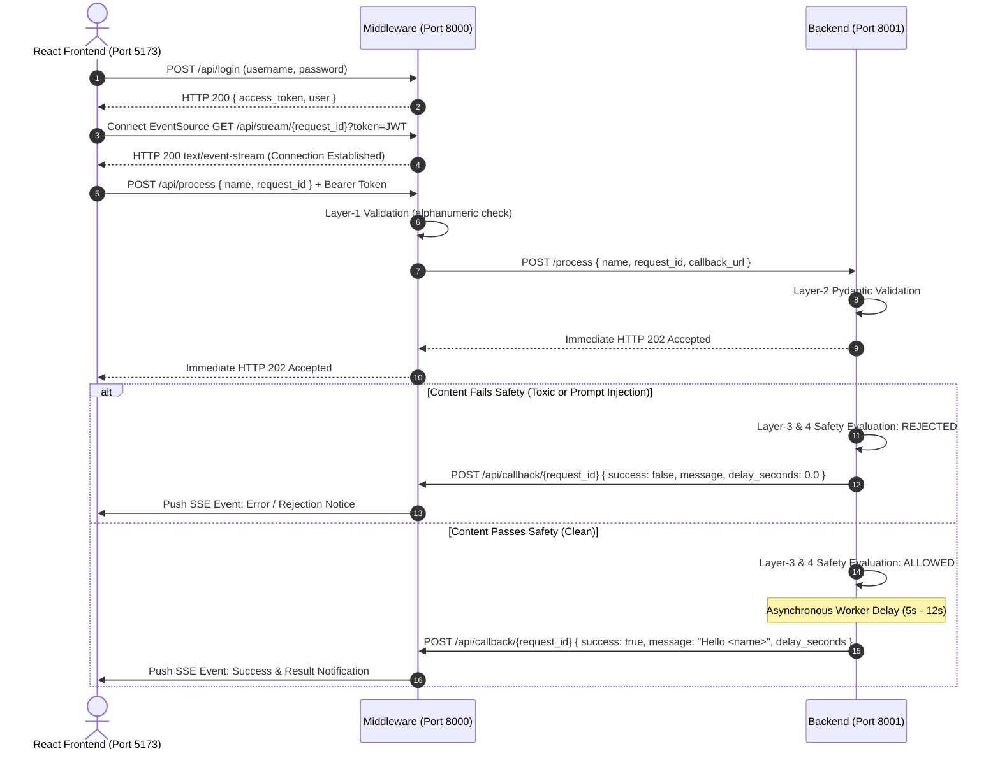

# 3-Tier Asynchronous Architecture & Safety Guard System

This document provides a comprehensive technical reference for the 3-Tier Web Application, detailing its component hierarchy, multi-layer validation pipeline, zero-shot neural safety guard, asynchronous webhook callback pattern, and real-time Server-Sent Events (SSE) streaming.

---

## 🏗️ 1. High-Level System Architecture

The application is structured into three decoupled layers communicating over HTTP, asynchronous Webhook callbacks, and native Server-Sent Events (SSE):

```mermaid
graph TD
    subgraph Tier1 ["Tier 1: Client UI (Port 5173)"]
        UI["React 18 + Vite (TypeScript)"]
        ES["Native EventSource (SSE Listener)"]
    end

    subgraph Tier2 ["Tier 2: Middleware Gateway (Port 8000)"]
        AUTH["JWT Authentication (/api/login)"]
        VAL1["Layer-1: Input Sanitization & Validation"]
        SSE_MGR["SSE Queue Manager (asyncio.Queue)"]
        WEBHOOK["Webhook Receiver (/api/callback/{id})"]
    end

    subgraph Tier3 ["Tier 3: Backend Worker & Safety Guard (Port 8001)"]
        VAL2["Layer-2: Pydantic Schema Validator"]
        FAST_FILTER["Layer-3: High-Speed Pre-Filter (<0.001s)"]
        OPIR["Layer-4: OPIR Neural Safety Guard (~250ms)"]
        WORKER["Async Job Worker (5s - 12s simulated delay)"]
        HTTPX["HTTPX Async Client (Webhook Trigger)"]
    end

    UI -->|1. POST /api/login| AUTH
    UI -->|2. Connect SSE /api/stream/{id}?token=JWT| ES
    ES <-->|Real-time Event Stream| SSE_MGR
    UI -->|3. POST /api/process + Bearer Token| VAL1
    VAL1 -->|4. Forward POST /process + callback_url| VAL2
    VAL2 -->|5. Immediate HTTP 202 Accepted| VAL1
    VAL1 -->|6. Immediate HTTP 202 Accepted| UI
    VAL2 -->|7. Evaluate Safety| FAST_FILTER
    FAST_FILTER -->|Pass to Neural Engine| OPIR
    OPIR -->|If Toxic/Injection: Skip Delay| HTTPX
    OPIR -->|If Safe: 5s-12s Processing| WORKER
    WORKER -->|Job Complete| HTTPX
    HTTPX -->|8. POST Webhook /api/callback/{id}| WEBHOOK
    WEBHOOK -->|9. Push Event to Queue| SSE_MGR
    SSE_MGR -->|10. Stream Update to Browser| ES
```

---

## 📦 2. Tier Breakdown & Technology Stack

| Tier | Component | Technology | Port | Primary Responsibilities |
| :--- | :--- | :--- | :--- | :--- |
| **Tier 1** | **Client Layer** | React 18, TypeScript, Vite, Vanilla CSS | `5173` | User input form, JWT session management, native `EventSource` SSE listener, live interactive audit logs & toast notifications. |
| **Tier 2** | **Middleware Gateway** | FastAPI, Uvicorn, HTTPX, Pydantic | `8000` | HS256 JWT auth (`/api/login`), Layer-1 input sanitization, in-memory `asyncio.Queue` per request, and Webhook callback receiver (`/api/callback/{id}`). |
| **Tier 3** | **Backend Worker** | FastAPI, Uvicorn, PyTorch, GLiClass, Transformers | `8001` | Layer-2 Pydantic validation, Layer-3 regex fast filter, Layer-4 `knowledgator/opir-multitask-multilang-v1.0` safety classifier, async worker, and Webhook dispatch. |

---

## 🛡️ 3. Multi-Layer Input Validation & Safety Pipeline

Every user prompt passes through four defensive evaluation layers before any long-running computation occurs:

```
[ User Input ]
      │
      ▼
┌────────────────────────────────────────────────────────┐
│ Layer 1: Middleware Input Sanitization (Port 8000)      │
│ • Validates minimum length and non-whitespace content. │
│ • Rejects inputs composed exclusively of special chars.│
└────────────────────────────────────────────────────────┘
      │
      ▼
┌────────────────────────────────────────────────────────┐
│ Layer 2: Backend Pydantic Schema Validation (Port 8001)│
│ • Validates non-empty string and alphanumeric presence.│
│ • Validates request_id correlation ID & callback_url.  │
└────────────────────────────────────────────────────────┘
      │
      ▼
┌────────────────────────────────────────────────────────┐
│ Layer 3: High-Speed Fast Pattern Pre-Filter (<0.001s)  │
│ • DIRECT_ATTACK_PATTERNS: Obvious slurs & profanities. │
│ • TARGETED_HARASSMENT_PATTERNS: Bullying & hostility.  │
│ • PROMPT_INJECTION_PATTERNS: "ignore previous rules".  │
│ • CONTEXTUAL_EXEMPTION_PATTERNS: Educational quotes.   │
└────────────────────────────────────────────────────────┘
      │
      ▼
┌────────────────────────────────────────────────────────┐
│ Layer 4: OPIR Neural Safety Model (~250ms on CPU)      │
│ • Model: knowledgator/opir-multitask-multilang-v1.0    │
│ • PyTorch CPU thread tuning: torch.set_num_threads(4)  │
│ • Single-label discrimination: benign vs toxic comment │
└────────────────────────────────────────────────────────┘
      │
      ├───────────────────────────────┐
      ▼                               ▼
[ If Rejected / Toxic ]     [ If Clean / Allowed ]
• delay_seconds = 0.0s      • delay_seconds = 5.0s - 12.0s
• Immediate Webhook Callback • Background execution delay
• Skip heavy processing     • Webhook Callback on finish
```

---

## ⚡ 4. Asynchronous Webhook Callback & SSE Sequence Flow



---

## ⚙️ 5. Configuration & Environment Variables

| Variable | Service | Default Value | Description |
| :--- | :--- | :--- | :--- |
| `JWT_SECRET_KEY` | Middleware | `"jwt-secret-key-frontend-to-middleware-2026"` | HMAC-SHA256 signing secret for JWT tokens. |
| `JWT_EXPIRE_MINUTES` | Middleware | `60` | Token expiration period in minutes. |
| `BACKEND_URL` | Middleware | `"http://127.0.0.1:8001/process"` | Target URL for dispatching jobs to backend. |
| `MIDDLEWARE_HOST` | Middleware | `"http://127.0.0.1:8000"` | Base URL used to construct the dynamic webhook callback URL. |
| `MODEL_NAME` | Backend | `"knowledgator/opir-multitask-multilang-v1.0"` | Safety transformer model identifier on Hugging Face. |
| `TOXICITY_THRESHOLD` | Backend | `0.50` | Floating-point cutoff score (0.0 - 1.0) for toxicity classification. |
| `VITE_MIDDLEWARE_URL`| Frontend | `"http://localhost:8000"` | Middleware base URL consumed by React frontend. |

---

## 🔒 6. Defensiveness & Future-Proofing Guidelines

To ensure future enhancements do not introduce regressions or runtime failures:

1. **Defensive Input Handling:**
   * Both `fast_heuristic_check` and `classify_text_sync` in `backend/toxicity.py` sanitize inputs, gracefully returning safe defaults for `None`, non-string, or empty text.
2. **Multi-Format Pipeline Parser:**
   * The classification results parser supports both nested lists (`[[{'label': '...', 'score': ...}]]`) and dictionaries (`{'labels': [...], 'scores': [...]}`), protecting against upstream library changes in GLiClass or Transformers.
3. **Safe Environment Variable Parsing:**
   * Numerical configuration values (such as `TOXICITY_THRESHOLD`) are wrapped in `try/except (ValueError, TypeError)` blocks with safe fallbacks.
4. **Backend Failure Transparency:**
   * If the Backend is unreachable, Middleware immediately pushes an error event to the active client SSE queue and responds with HTTP `502 Bad Gateway`, preventing hanging requests.
5. **Thread Contention Mitigation:**
   * `torch.set_num_threads(4)` is enforced globally on CPU to prevent OpenMP thread lock contention on multi-core servers (350x faster execution).
