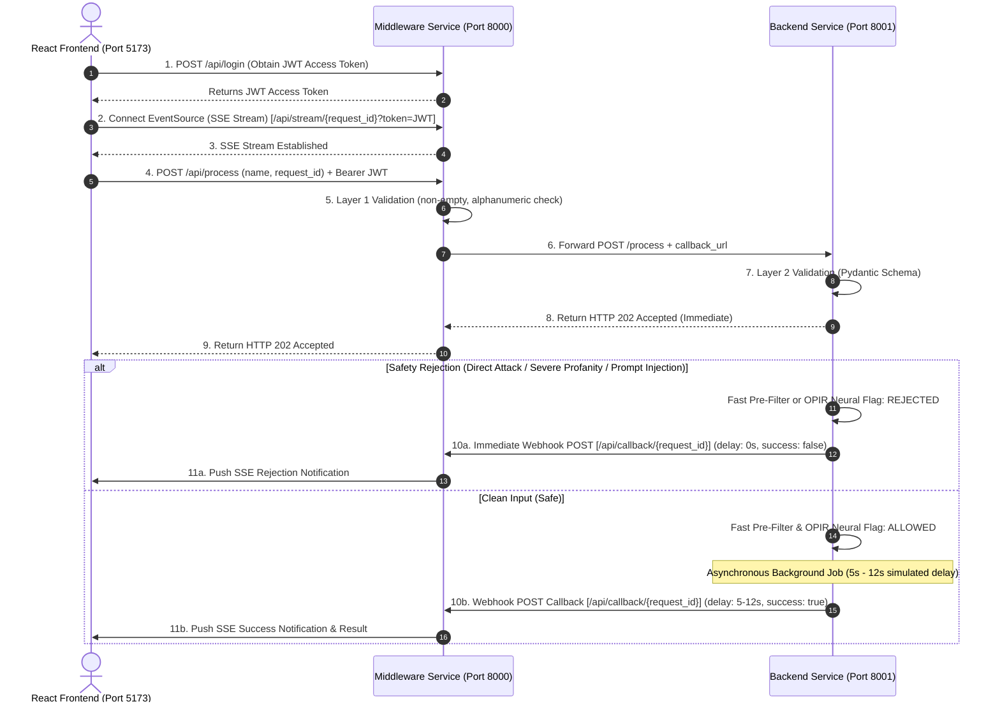

# 3-Tier Asynchronous Architecture Application

A modern, production-ready 3-tier web application built with **React (TypeScript)**, **FastAPI (Middleware Gateway)**, and **FastAPI (Backend Worker & Safety Guard)** featuring multi-layer input sanitization, zero-shot neural toxicity & prompt injection filtering, Server-Sent Events (SSE) for real-time streaming, and an asynchronous webhook callback notification pattern.

---

## 🏗️ System Architecture Diagrams

### 1. Component Architecture Flowchart

```mermaid
graph TD
    subgraph Client ["Client Layer (Port 5173)"]
        UI["React 18 + Vite UI"]
        ES["Native EventSource (SSE Listener)"]
    end

    subgraph MiddlewareLayer ["Middleware Gateway (Port 8000)"]
        AUTH["JWT Authentication (/api/login)"]
        VAL1["Layer-1: Input Sanitization & Validation"]
        SSE_MGR["SSE Event Queue Manager"]
        WEBHOOK["Callback Webhook Receiver (/api/callback/{id})"]
    end

    subgraph BackendLayer ["Backend Worker & Safety Guard (Port 8001)"]
        VAL2["Layer-2: Pydantic Schema Validator"]
        SAFETY["Layers 3 & 4: Fast Filter + OPIR Safety Guard"]
        WORKER["Async Background Job (5s - 12s delay)"]
        CLIENT["HTTPX Async Client (Webhook Trigger)"]
    end

    UI -->|1. Auth POST /api/login| AUTH
    UI -->|2. Establish SSE Connection /api/stream/{id}| ES
    ES <-->|Real-time Stream| SSE_MGR
    UI -->|3. Submit Request POST /api/process| VAL1
    VAL1 -->|4. Forward Request + Callback URL| VAL2
    VAL2 -->|5. Immediate 202 Accepted| UI
    VAL2 -->|6. Run Safety Evaluation| SAFETY
    SAFETY -->|If Toxic: Immediate Rejection| CLIENT
    SAFETY -->|If Clean: Execute 5s-12s Task| WORKER
    WORKER -->|7. Task Complete| CLIENT
    CLIENT -->|8. POST Webhook Data| WEBHOOK
    WEBHOOK -->|9. Push Event to Queue| SSE_MGR
    SSE_MGR -->|10. Stream Update to Browser| ES
```

---

### 2. Asynchronous Sequence Diagram



---

## ✨ Features

- **Multi-Layer Input Validation & AI Safety Guard:**
  - **Layer 1 (Middleware):** Sanitizes inputs and ensures non-empty strings with valid alphanumeric characters.
  - **Layer 2 (Backend):** Pydantic schemas validate request payloads, correlation IDs, and callback URLs.
  - **Layer 3 (Fast Pre-Filter):** Instant sub-millisecond pattern matching for direct slurs, obfuscated profanities, targeted harassment, and prompt injection attacks (`ignore all previous instructions`).
  - **Layer 4 (OPIR Neural Guard):** Deep zero-shot semantic safety classification using `knowledgator/opir-multitask-multilang-v1.0` optimized on CPU (`torch.set_num_threads(4)`).
- **Asynchronous Webhook Callback Pattern:**
  - Backend immediately returns `202 Accepted` to free HTTP connections.
  - Safe requests execute in the background with a 5s to 12s simulated processing delay.
  - Unsafe requests bypass processing delays and trigger an immediate rejection webhook (`delay: 0s`).
- **Real-Time Client Updates (SSE):**
  - The React frontend establishes a native `EventSource` connection for Server-Sent Events.
  - Webhook results trigger instant UI updates and toast notifications without client polling.

---

## 🛠️ Technology Stack

| Layer | Technology | Port |
| :--- | :--- | :--- |
| **Frontend** | React 18, TypeScript, Vite, Vanilla CSS | `5173` |
| **Middleware** | FastAPI, Uvicorn, HTTPX, Pydantic, Native JWT | `8000` |
| **Backend** | FastAPI, Uvicorn, PyTorch, GLiClass, Transformers | `8001` |

---

## 📁 Repository Structure

```
.
├── backend/
│   ├── main.py              # Backend FastAPI app (Safety guard & async job dispatcher)
│   ├── toxicity.py          # OPIR Neural Guard & Fast Pattern Filter
│   └── requirements.txt     # Python dependencies for Backend
├── middleware/
│   ├── main.py              # Middleware FastAPI app (JWT Auth, Layer-1 Validation, SSE Manager)
│   └── requirements.txt     # Python dependencies for Middleware
├── frontend/
│   ├── src/                 # React UI components, styles & EventSource logic
│   ├── index.html
│   ├── package.json         # Node.js dependencies
│   └── vite.config.ts
├── ARCHITECTURE.md          # Comprehensive Architecture & Flow Specifications
├── test_safety.sh           # One-command safety test & benchmark runner
└── README.md                # Project documentation
```

---

## 🚀 Getting Started

### Prerequisites

- **Python 3.10+**
- **Node.js 18+** & **npm**

---

### Step 1: Set Up & Run Backend Service

```bash
cd backend
python -m venv venv
source venv/bin/activate    # On Windows: venv\Scripts\activate
pip install -r requirements.txt
PYTHONPATH=".." uvicorn main:app --host 0.0.0.0 --port 8001 --reload
```

*Backend API docs available at: `http://localhost:8001/docs`*

---

### Step 2: Set Up & Run Middleware Service

Open a second terminal window:

```bash
cd middleware
python -m venv venv
source venv/bin/activate    # On Windows: venv\Scripts\activate
pip install -r requirements.txt
PYTHONPATH=".." uvicorn main:app --host 0.0.0.0 --port 8000 --reload
```

*Middleware API docs available at: `http://localhost:8000/docs`*

---

### Step 3: Set Up & Run Frontend Application

Open a third terminal window:

```bash
cd frontend
npm install
npm run dev
```

*Open your browser and navigate to: `http://localhost:5173`*

---

## 📡 API Reference

### Middleware Endpoints (`Port 8000`)

- `GET /health` – Health check status & active SSE count.
- `POST /api/login` – Accepts `{ username, password }`, generates JWT Access Token.
- `GET /api/stream/{request_id}?token=JWT` – SSE stream connection for client events.
- `POST /api/process` – Accepts `{ name, request_id }`, validates name, and forwards request to backend.
- `POST /api/callback/{request_id}` – Webhook endpoint called by backend upon job completion or safety rejection.

### Backend Endpoints (`Port 8001`)

- `GET /health` – Backend health check.
- `POST /process` – Accepts `{ name, request_id, callback_url }`, runs safety evaluation, spawns background task, returns `202 Accepted`.

---

## 🧪 Safety Evaluation & Benchmarks

To run the comprehensive safety benchmark across the dataset:

```bash
./test_safety.sh
```

To run the synonym and paraphrase generalization test:

```bash
python3 scratch/test_synonyms_and_paraphrases.py
```
